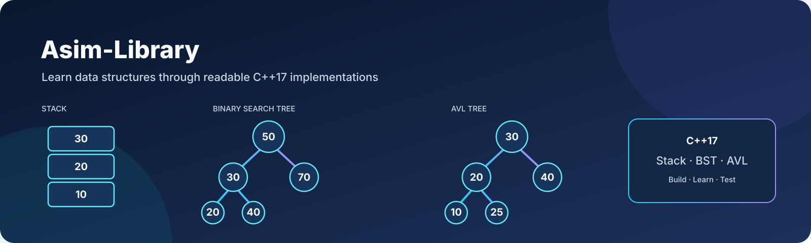

# 📚 Asim-Library

  
  <h1>Asim-Library</h1>
  
<strong>An educational C++17 library for learning linear and tree-based data structures.</strong>

  
Understand the algorithms. Inspect the invariants. Test the memory ownership.

  

    
    
    
    
    
    
    
    
    
  

  
   

  
<a href="#-overview">Overview</a> · <a href="#-build-and-run">Build</a> · <a href="docs/README.md">Documentation</a> · <a href="docs/api.md">API</a>

---

## 🧭 Contents
- [Overview](#-overview)
- [Features](#-features)
- [Architecture and algorithms](#-architecture-and-algorithms)
- [Project structure](#-project-structure)
- [Build and run](#-build-and-run)
- [API quick start](#-api-quick-start)
- [Behavior and complexity](#-behavior-and-complexity)
- [Testing and quality](#-testing-and-quality)
- [Limitations and roadmap](#-limitations-and-roadmap)
- [Documentation](#-documentation)
- [Contributing and license](#-contributing-and-license)

## 🌍 Overview

Asim-Library is a compact native C++ project for studying three classic data structures: a fixed-capacity integer stack, an integer Binary Search Tree (BST), and an integer AVL tree. The repository contains an interface header, implementation file, console demonstration, CMake build, and automated regression tests.

The project is educational. It exposes the mechanics of insertion, lookup, deletion, traversal, balancing, and memory ownership instead of wrapping the standard library containers. For production software, prefer tested standard-library containers unless using these implementations is an explicit requirement.

## ✨ Features

| Component | Capabilities |
|---|---|
| Stack | Fixed capacity, push, pop, peek, search, occupied-sequence rotations, display, clear |
| BST | Unique-key insertion, lookup, in-order traversal, deletion, size and height |
| AVL Tree | Unique-key insertion/deletion, search, four rotation cases, balance verification, traversal, size and height |
| Ownership | Tree destruction, deep-copy construction/assignment, move construction/assignment |
| Testing | Stack boundaries, BST deletion cases, AVL rotations, copy/move independence |
| Build | C++17 target, CMake, CTest, direct compiler example |

## 🧱 Architecture and algorithms

The public contract lives in `asim_library.h`; `asim_library.cpp` contains the implementation. `main.cpp` demonstrates usage, while `tests/test_asim_library.cpp` verifies behavior independently.

### Component relationship

~~~mermaid
flowchart TD
  Header[asim_library.h: public declarations] --> Source[asim_library.cpp: implementations]
  Header --> Demo[main.cpp: console demo]
  Header --> Tests[tests/test_asim_library.cpp: regression tests]
  CMake[CMakeLists.txt] --> Source
  CMake --> Demo
  CMake --> Tests
~~~

### AVL rebalance decision

~~~mermaid
flowchart TD
  A[Insert or delete in BST order] --> B[Update node height]
  B --> C[Calculate left height minus right height]
  C --> D{Balance factor}
  D -->|Greater than 1| E{Left child balance}
  D -->|Less than -1| F{Right child balance}
  D -->|Within -1 to 1| G[Keep node]
  E -->|Non-negative| H[Right rotation: LL]
  E -->|Negative| I[Left then right: LR]
  F -->|Non-positive| J[Left rotation: RR]
  F -->|Positive| K[Right then left: RL]
  G --> L[Return subtree root]
  H --> L
  I --> L
  J --> L
  K --> L
~~~

See [project overview](docs/project-overview.md), [algorithms](docs/algorithms.md), [architecture](docs/architecture.md), and [diagram index](docs/diagrams/README.md).

## 🖼️ Visual assets

The repository includes an original SVG project banner and editable Mermaid flowcharts for the stack, BST, AVL rotations, and build/test pipeline. See [asset guidance](assets/README.md) and [diagram catalogue](docs/diagrams/README.md). These are technical illustrations, not screenshots of a GUI.

## 🗂️ Project structure

~~~text
Asim-Library/
├── .github/
│   ├── ISSUE_TEMPLATE/
│   ├── workflows/
│   │   ├── ci.yml
│   │   ├── documentation.yml
│   │   └── security.yml
│   └── PULL_REQUEST_TEMPLATE.md
├── assets/
│   ├── asim-library-banner.svg
│   └── diagrams/
├── docs/
│   ├── ADRs/
│   ├── diagrams/
│   └── engineering and API guides
├── tests/
│   └── test_asim_library.cpp
├── asim_library.h
├── asim_library.cpp
├── main.cpp
└── CMakeLists.txt
~~~

See [the complete file map](docs/project-structure.md).

## 🧰 Requirements

- C++17-compatible compiler (GCC, Clang, or MSVC with C++17 support).
- CMake 3.16 or later.
- Git.
- No third-party runtime dependencies.

## 🚀 Build and run

### Clone the repository

~~~bash
git clone https://github.com/Brajesh31/Asim-Library.git
cd Asim-Library
~~~

### Configure and build

~~~bash
cmake -S . -B build -DCMAKE_BUILD_TYPE=Release
cmake --build build --parallel
~~~

### Run the demonstration

Linux/macOS:

~~~bash
./build/asim_library_demo
~~~

Windows with a Visual Studio multi-configuration generator:

~~~powershell
.\build\Release\asim_library_demo.exe
~~~

### Run automated tests

~~~bash
ctest --test-dir build --output-on-failure
~~~

### Direct compiler route

~~~bash
g++ -std=c++17 -Wall -Wextra -Wpedantic asim_library.cpp main.cpp -o asim-library
./asim-library
~~~

## 🧪 API quick start

### Stack

~~~cpp
#include "asim_library.h"

int main() {
    Stack values(3);
    values.push(10);
    values.push(20);
    int currentTop = values.peek(); // 20
    int removed = values.pop();     // 20
    values.rotateLeft();
    return currentTop == removed ? 0 : 1;
}
~~~

### BST

~~~cpp
#include "asim_library.h"
#include <sstream>

int main() {
    BST tree;
    for (int value : {40, 20, 60, 10}) tree.insert(value);
    bool exists = tree.search(20);
    tree.deleteNode(20);
    std::ostringstream sorted;
    tree.inOrderTraversal(sorted);
    return exists ? 0 : 1;
}
~~~

### AVL Tree

~~~cpp
#include "asim_library.h"

int main() {
    AVLTree tree;
    for (int value : {10, 20, 30, 40, 50, 25}) tree.insert(value);
    if (!tree.isBalanced()) return 1;
    tree.deleteNode(30);
    return tree.isBalanced() ? 0 : 1;
}
~~~

Invalid stack operations throw standard exceptions: `std::invalid_argument` for negative capacity, `std::overflow_error` for push on full, and `std::underflow_error` for empty pop/peek. Duplicate tree keys are ignored. See the full [API reference](docs/api.md).

## 📏 Behavior and complexity

| Operation | Stack | BST | AVL Tree |
|---|---:|---:|---:|
| Insert/push | O(1) amortized | O(h) | O(log n) |
| Search | O(n) | O(h) | O(log n) |
| Remove/delete | O(1) | O(h) | O(log n) |
| Traversal | N/A | O(n) | O(n) |
| Height query | N/A | O(n) | O(1) |

The BST can degrade to O(n) height for sorted insertion. AVL maintains O(log n) height. Full analysis is in [complexity.md](docs/complexity.md).

## ✅ Testing and quality

The test suite covers stack capacity/error cases, rotations, BST leaf/one-child/two-child deletion, duplicate handling, and deep-copy/move behavior. AVL tests cover LL, RR, LR, and RL rotations, deletion, and invariant checks after mutations.

CI builds with GCC and Clang, runs CTest, executes the demo, and includes sanitizer testing. Documentation validation checks local Markdown links and code fences. The security workflow scans repository history and compiles with hardening flags.

## ⚠️ Limitations and roadmap

- Structures store integers only, not generic templates.
- Stack capacity is fixed at construction.
- BST does not self-balance; use AVLTree for guaranteed logarithmic height.
- There are no iterators, range queries, duplicate counters, persistence, serialization, or concurrency guarantees.
- CMake install/export packaging is not yet configured.
- This remains an educational project, not a drop-in replacement for STL containers.

Planned improvements are listed in [ROADMAP.md](ROADMAP.md).

## 📚 Documentation

| Guide | Details |
|---|---|
| [Documentation index](docs/README.md) | Full documentation catalogue |
| [Project overview](docs/project-overview.md) | Audience, goals, learning objectives and scope |
| [Limitations](docs/limitations.md) | Current boundaries and unsupported capabilities |
| [Persistence strategy](docs/backup-and-persistence.md) | In-memory behavior and future serialization guidance |
| [API reference](docs/api.md) | Class contracts, method behavior and exceptions |
| [Algorithms](docs/algorithms.md) | Stack, BST and AVL algorithms |
| [Architecture](docs/architecture.md) | Modules and ownership |
| [Complexity](docs/complexity.md) | Time and space analysis |
| [Installation](docs/installation.md) | Compiler, CMake and platform setup |
| [Development](docs/development.md) | Engineering and contribution guidance |
| [Testing](docs/testing.md) | Test scope and verification |
| [Design decisions](docs/design-decisions.md) | API and implementation trade-offs |
| [Troubleshooting](docs/troubleshooting.md) | Build and behavior diagnostics |
| [FAQ](docs/faq.md) | Common questions |
| [Persistence](docs/database.md) | In-memory ownership and persistence scope |
| [Limitations](docs/limitations.md) | Known boundaries |

## 🤝 Contributing and license

Read [CONTRIBUTING.md](CONTRIBUTING.md) before submitting changes. Include regression tests and update API/complexity documentation when behavior changes.

Distributed under the [MIT License](LICENSE). Maintained by **Brajesh Kumar**, [@Brajesh31](https://github.com/Brajesh31).

Last updated: 2026-11-16 16:59 UTC
