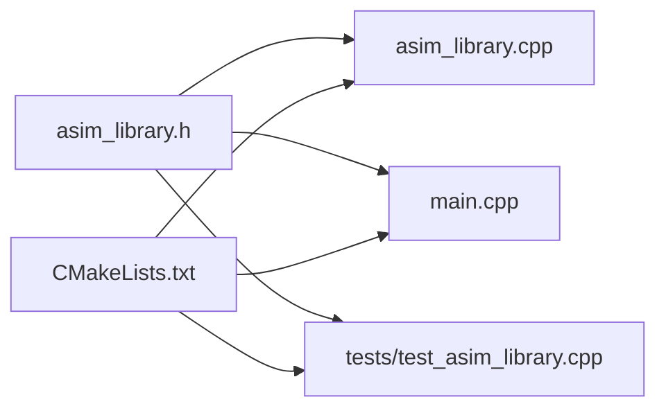

# 🏗️ Architecture and implementation design

## 1. Overview

Asim-Library is a local C++17 library. It has no network service, database, environment-driven configuration, or external runtime dependency. The design is a small interface/implementation pair plus a demonstration executable and a separate test executable.

## 2. Source layout

| File | Responsibility |
|---|---|
| asim_library.h | Public declarations, class contracts, ownership semantics |
| asim_library.cpp | Stack, BST and AVLTree implementation |
| main.cpp | Console demonstration program |
| tests/test_asim_library.cpp | Automated behavior and regression tests |
| CMakeLists.txt | Build targets, compiler feature requirements, CTest integration |

## 3. Dependency graph

The header does not import `using namespace std`. Standard-library names are explicitly qualified. The public interface uses forward declarations where practical and includes only the types needed for public signatures.

## 4. Stack design

The Stack stores values in `std::vector<int>` and separately records the fixed capacity. Reserving the capacity at construction avoids repeated reallocations while the stack remains within its configured limit. The vector size represents the occupied elements, so rotation only touches live values.

The class has value semantics through its standard-library-owned storage. It does not manually allocate or release an array.

## 5. BST design

The BST uses raw child pointers to keep the node relationships visible for teaching. The owning BST controls the root and is responsible for recursively destroying nodes. It defines all special member functions:
- Destructor releases nodes.
- Copy constructor clones the node topology.
- Copy assignment uses copy-and-swap for a strong exception guarantee.
- Move constructor/assignment transfer the root and reset the source.

The tree tracks unique-key count separately. Deletion handles zero, one, and two-child cases.

## 6. AVL design

AVLTree uses the same visible pointer-node model but stores a height in each node. Every changed ancestor is re-evaluated on the return path from recursive insertion/deletion. Rebalancing uses the child balance factor to choose a single or double rotation.

The implementation centralizes height updates and rebalancing so insertion and deletion share the same rotation logic.

## 7. Output boundary

Traversal methods accept an optional `std::ostream&`. This keeps the basic demo API while allowing tests and consumers to capture output without redirecting global process streams.

## 8. Ownership invariant

Every node reachable from a tree root is owned by that tree. A node must not be deleted by a consumer. Copies create separate node graphs. Moves leave the source empty. The node types are public for learning but should not be treated as an ownership-transfer API.

## 9. Error policy

Invalid stack capacities and invalid stack operations are reported with standard exceptions. Tree lookup uses boolean results; absent deletion does nothing. Tree memory cleanup is performed by destructors and clear methods.

## 10. Design boundaries

The current implementation is integer-only, single-threaded, in-memory, and educational. Templates, iterators, persistence, concurrency, benchmarks, and install/export packaging are not implemented.
